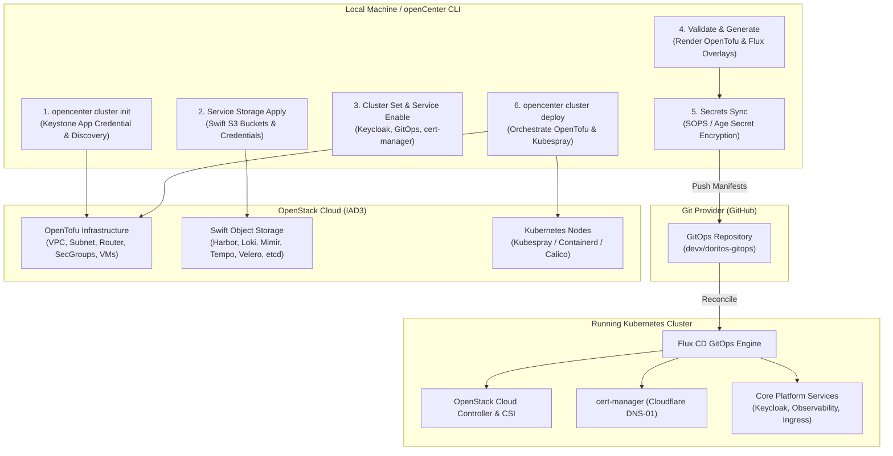

# Deploy an OpenStack Cluster: Verified Walkthrough

**Purpose:** This guided tutorial walks through the complete, verified workflow for configuring, provisioning, and deploying a production-ready Kubernetes cluster on OpenStack using the openCenter CLI, based on the verified deployment of the **doritos** cluster in the **opensnack** organization using **openCenter CLI v1.0.0-rc07** and **Lifecycle Contract v3**.

---

## Overview and Architecture

openCenter orchestrates Kubernetes clusters across infrastructure providers through declarative configuration, infrastructure-as-code, and GitOps delivery. This walkthrough targets **openCenter CLI v1.0.0-rc07**, which synchronizes upstream `openCenter-gitops-base` to `2026.03-rc05` and advances to **Lifecycle Contract v3** for automated OpenTofu network output binding into the Cloud Controller Manager (CCM).



### The Doritos Deployment Profile

The deployment documented here reflects the real-world cluster configuration for `doritos`:

| Parameter | Value in Verified Deployment | Description |
|---|---|---|
| **openCenter Version** | `v1.0.0-rc07` | CLI release candidate with Lifecycle Contract v3 |
| **Upstream GitOps Base** | `2026.03-rc05` | Pinned OpenTofu and Helm base module tag |
| **Organization (`ORG`)** | `opensnack` | Multi-tenant namespace within openCenter |
| **Cluster Name (`CLUSTER`)** | `doritos` | Target cluster identifier |
| **Cloud Profile (`OS_CLOUD`)** | `octr-dev-iad3` | OpenStack profile defined in `clouds.yaml` |
| **Git Target (`GH_ORG`)** | `devx` | GitHub organization hosting the GitOps repository |
| **Base DNS Domain** | `k8s.opensnack.cloud` | Public root domain for cluster routing and TLS |
| **Cluster FQDN** | `doritos.iad3.k8s.opensnack.cloud` | Fully qualified domain name assigned to the cluster |
| **Swift S3 Endpoint** | `https://swift.api.iad3.rackspacecloud.com` | Object storage endpoint for stateful services |
| **DNS Provider** | Cloudflare (or AWS Route53) | DNS-01 ACME challenge provider for cert-manager |

---

## Prerequisites

Before beginning, ensure the following requirements are met:

1. **openCenter CLI & Local Plugin (v1.0.0-rc07)**: Installed and available in your `$PATH`. Install via the curl installer:
   ```bash
   curl -fsSL https://raw.githubusercontent.com/opencenter-cloud/openCenter-cli/main/scripts/install.sh | bash -s -- --version v1.0.0-rc07
   ```
   Verify the installation and plugin registration:
   ```bash
   opencenter version
   opencenter plugins list
   ```
2. **OpenStack Cloud Profile**: A functional profile in `~/.config/openstack/clouds.yaml` (e.g., `octr-dev-iad3`) with permissions to create instances, volumes, networks, routers, and Keystone application credentials.
3. **OpenStack Quotas**: Sufficient compute cores, RAM, floating IPs, and server groups.
4. **Git Provider Account**: Access to GitHub (or GitLab) with permissions to create private repositories, and an authenticated GitHub Personal Access Token (PAT) with repo write permissions (`GH_BOOTSTRAP_TOKEN`).
5. **DNS Provider**: An active Cloudflare API token with `Zone:DNS:Edit` permissions, or an AWS IAM access key with Route53 update permissions.
6. **Local Tools**:
   - `git`
   - `openssl` (for secure password generation)
   - `gh` (GitHub CLI, optional but recommended)
   - `kubectl` (for cluster verification)

---

## Step 1: Set Environment Variables

Define the deployment parameters in your shell session. Using environment variables avoids hardcoding secrets and streamlines subsequent commands:

```bash
# Core Cluster Identity
export ORG=opensnack
export CLUSTER=doritos
export GH_ORG=devx
export BASE_DOMAIN=k8s.opensnack.cloud
export ADMIN_EMAIL=mpk-support@rackspace.com

# Infrastructure & Storage
export OS_CLOUD=octr-dev-iad3
export S3_ENDPOINT=https://swift.api.iad3.rackspacecloud.com

# Authentication & Credentials
export GH_BOOTSTRAP_TOKEN="$(cat ~/.config/gh/my-org-gh.token)"
export CLOUDFLARE_DNS_EMAIL=palma.victor@gmail.com
export CLOUDFLARE_API_TOKEN="$(cat ~/.config/cloudflare/opensnack.token)"
```

> [!TIP]
> If your token files live in different locations, update the paths in the `cat` statements accordingly. Keep token files with `chmod 0600` permissions.

### Verify Variables

Sanity check that all variables are populated before proceeding:

```bash
echo "ORG:                  $ORG"
echo "CLUSTER:              $CLUSTER"
echo "GH_ORG:               $GH_ORG"
echo "BASE_DOMAIN:          $BASE_DOMAIN"
echo "ADMIN_EMAIL:          $ADMIN_EMAIL"
echo "OS_CLOUD:             $OS_CLOUD"
echo "S3_ENDPOINT:          $S3_ENDPOINT"
echo "GH_BOOTSTRAP_TOKEN:   ${GH_BOOTSTRAP_TOKEN:0:4}... (length: ${#GH_BOOTSTRAP_TOKEN})"
echo "CLOUDFLARE_DNS_EMAIL: $CLOUDFLARE_DNS_EMAIL"
echo "CLOUDFLARE_API_TOKEN: ${CLOUDFLARE_API_TOKEN:0:4}... (length: ${#CLOUDFLARE_API_TOKEN})"
```

---

## Step 2: Initialize Cluster Configuration

Initialize the cluster configuration file in one unified step:

```bash
opencenter cluster init $CLUSTER \
  --org $ORG \
  --type openstack \
  --os-cloud $OS_CLOUD \
  --base-domain $BASE_DOMAIN \
  --yes
```

### What Happens During Initialization:

1. **Blueprint Creation**: Generates the v2 configuration blueprint at:
   ```text
   ~/.config/opencenter/clusters/blueprints/opensnack/doritos/doritos-config.yaml
   ```
2. **Keystone Credential Minting**: Interrogates the `$OS_CLOUD` profile in `clouds.yaml`. If no application credential exists, openCenter automatically creates one via Keystone, saves it back into `clouds.yaml` with mode `0600`, and records the ID and secret in the cluster blueprint.
3. **Live Cloud Discovery**: Discovers images (resolving default Ubuntu 24.04), availability zones, and flavor specifications directly from the OpenStack region (`iad3`).
4. **Dedicated Tenant Networking**: Defaults to OpenTofu-managed networking (`--create-internal-network`), which will create an isolated tenant network, subnet, and router. This prevents routing collisions with other clusters in the same tenant project.
5. **Key Generation**: Generates cluster Age encryption keys for SOPS and SSH key pairs for instance access.

### Networking Modes: Managed vs Existing

| Mode | When to Use | Flags |
|---|---|---|
| **OpenTofu-managed (Default)** | Multiple clusters in the same project, or full OpenTofu ownership | `--create-internal-network` (default) |
| **Existing Tenant Network** | Dedicated single-cluster network managed outside OpenTofu | `--create-internal-network=false --network-id <net> --subnet-id <subnet>` |

> [!WARNING]
> Attaching an existing shared subnet with `--create-internal-network=false` causes OpenTofu to create a second router interface on that subnet, which will fail with `IpAddressAlreadyAllocated` if another router is already attached. Use OpenTofu-managed networking unless your network architecture strictly demands external routing.

### Capacity Planning & Flavor Availability

Before provisioning, confirm that the chosen flavors exist in your OpenStack region and that quota is sufficient:

```bash
openstack --os-cloud $OS_CLOUD flavor list | grep gp.
openstack --os-cloud $OS_CLOUD quota show
openstack --os-cloud $OS_CLOUD server group list
```

A standard cluster (1 bastion + 1 master + 2 workers) requires approximately 14 vCPUs and 28 GB RAM. If your project quota is constrained, adjust instance counts with `cluster set`:

```bash
opencenter cluster set $ORG/$CLUSTER \
  opencenter.infrastructure.compute.master_count=1 \
  opencenter.infrastructure.compute.worker_count=2
```

---

## Step 3: Inspect Configuration and Set Active Context

Verify the freshly generated blueprint and set the cluster as the active working context:

```bash
# Describe the newly initialized cluster
opencenter cluster describe $ORG/$CLUSTER

# Switch CLI context to opensnack/doritos
opencenter cluster use $ORG/$CLUSTER

# Verify the active context
opencenter cluster describe
```

> [!NOTE]
> Running `opencenter cluster use` sets `$ORG/$CLUSTER` as the default target. While you can omit `$ORG/$CLUSTER` on subsequent commands, this guide explicitly provides `$ORG/$CLUSTER` for scripting safety and clarity.

---

## Step 4: Create the Remote GitOps Repository

Create a private, empty Git repository on GitHub (or your preferred Git provider) to hold the cluster's GitOps manifests:

```bash
gh repo create "$GH_ORG/$CLUSTER-gitops" --private --disable-wiki
```

> [!IMPORTANT]
> The remote GitOps repository **must be completely empty**. Do not initialize it with a `README.md`, `.gitignore`, or license file. The initial commit must come directly from openCenter's generated directory tree.

---

## Step 5: Provision Service Object Storage (Swift / S3)

Stateful platform services (Harbor registry, Loki logging, Mimir metrics, Tempo tracing, Velero backups, and etcd snapshot backups) require S3-compatible object storage.

Provision the required S3 storage containers and credentials in a single loop:

```bash
for service in harbor loki mimir tempo velero etcd-backup; do
  opencenter cluster service storage apply "$service" \
    --cluster "$ORG/$CLUSTER" \
    --backend s3 \
    --os-cloud "$OS_CLOUD" \
    --s3-endpoint "$S3_ENDPOINT" \
    --rotate-credentials \
    --yes
done
```

### What This Accomplishes:
- **Bucket Creation**: Interacts with the Swift S3 API at `$S3_ENDPOINT` to create dedicated buckets for each service.
- **Keystone EC2 Credentials**: Generates isolated EC2 credentials with `--rotate-credentials` for least-privilege service access.
- **Blueprint Updates**: Injects the generated endpoints, bucket names, and credential references directly into `doritos-config.yaml`.

---

## Step 6: Configure Core Platform Credentials and Properties

Next, configure the required administrator password, administrative contact, GitOps repository URL, and Git authentication tokens using `opencenter cluster set`.

### 1. Keycloak Admin Password

Keycloak manages identity and SSO across the cluster. Set a cryptographically secure random password:

```bash
opencenter cluster set $ORG/$CLUSTER \
  "secrets.keycloak.admin_password=$(openssl rand -base64 24)"
```

### 2. GitOps Authentication Token

Configure the token that Flux CD will use inside the cluster to authenticate to the GitHub repository over HTTPS:

```bash
opencenter cluster set $ORG/$CLUSTER \
  opencenter.gitops.auth.token.provider=github \
  "opencenter.gitops.auth.token.token=$GH_BOOTSTRAP_TOKEN"
```

### 3. GitOps Repository URL

Link the cluster configuration to the remote GitOps repository created in Step 4:

```bash
opencenter cluster set $ORG/$CLUSTER \
  opencenter.gitops.repository.url=https://github.com/$GH_ORG/$CLUSTER-gitops.git
```

### 4. Cluster Administrator Email

Set the primary administrator contact email for notifications and metadata:

```bash
opencenter cluster set $ORG/$CLUSTER \
  opencenter.cluster.admin_email=$ADMIN_EMAIL
```

---

## Step 7: Configure cert-manager for Automated TLS

openCenter integrates cert-manager to manage Let's Encrypt certificates using ACME DNS-01 challenges.

### Option A: Cloudflare (Used in Doritos)

For domains managed on Cloudflare (such as `k8s.opensnack.cloud`):

```bash
opencenter cluster service enable cert-manager \
  --param="email=$CLOUDFLARE_DNS_EMAIL" \
  --param="dns_provider=cloudflare" \
  --secret="cloudflare_api_token=$CLOUDFLARE_API_TOKEN" \
  --force
```

### Option B: AWS Route53 (Alternative)

If managing DNS in AWS Route53:

```bash
opencenter cluster service enable cert-manager \
  --param="email=$ADMIN_EMAIL" \
  --param="dns_provider=route53" \
  --param="region=us-east-1" \
  --secret="aws_access_key=<AWS_ACCESS_KEY_ID>" \
  --secret="aws_secret_access_key=<AWS_SECRET_ACCESS_KEY>" \
  --force
```

> [!NOTE]
> Setting `--force` overwrites any existing parameter defaults. The command registers the issuer configuration and provisions the appropriate Kubernetes Secret containing your API token.

---

## Step 8: Validate the Cluster Configuration

Before generating manifests or executing deployments, run offline validation to ensure all required fields, endpoints, and credentials satisfy the openCenter v2 schema:

```bash
opencenter cluster validate $ORG/$CLUSTER
```

Validation verifies:
- OpenStack Keystone authentication URLs, credentials, and image IDs.
- S3 endpoints and bucket bindings for all enabled services.
- Keycloak and GitOps secret parameters (rejecting default placeholders like `CHANGEME`).
- Domain FQDN formatting and cert-manager DNS provider settings.

> [!CAUTION]
> Validation **must pass with zero errors** before proceeding. If any error is reported, resolve it using `opencenter cluster set` and re-run validation.

---

## Step 9: Generate Manifests and Synchronize Encrypted Secrets

Once validation succeeds, generate the GitOps manifests and encrypt all secrets using SOPS and Age.

```bash
# 1. Generate infrastructure and application manifests
opencenter cluster generate $ORG/$CLUSTER --force

# 2. Synchronize and SOPS-encrypt all cluster secrets
opencenter secrets sync $ORG/$CLUSTER
```

### Understanding Generation and Secret Sync:
- `cluster generate`: Renders the OpenTofu infrastructure modules (`infrastructure/clusters/doritos/`) and the Flux application overlays (`applications/overlays/doritos/`).
- `secrets sync`: Inspects every generated service secret, reads the cluster's Age key, and encrypts the secret values in-place into valid SOPS YAML files.
- **Sanity check**: Confirm that secrets are encrypted and contain `ENC[...]` tokens:
  ```bash
  grep -rn "ENC\[" ~/.config/opencenter/clusters/gitops/$ORG/applications/overlays/$CLUSTER/
  ```

---

## Step 10: Commit and Push to the GitOps Repository

Publish the rendered manifests and encrypted secrets to the remote GitOps repository.

The local GitOps working tree is located under `~/.config/opencenter/clusters/gitops/$ORG`:

```bash
# Navigate to the local GitOps directory
cd ~/.config/opencenter/clusters/gitops/$ORG

# Initialize git tracking (if not already initialized)
git init
git branch -M main

# Stage and commit all generated files
git add -A
git commit -m "feat(cluster): initial GitOps manifests for $CLUSTER"

# Add the remote and push
git remote add origin https://github.com/$GH_ORG/$CLUSTER-gitops.git
# Or if using SSH:
# git remote add origin git@github.com:$GH_ORG/$CLUSTER-gitops.git

git push -u origin main
```

> [!IMPORTANT]
> **Push before deploying:** While openCenter can provision infrastructure before the repository is pushed, pushing **first** ensures that as soon as Kubespray finishes bootstrapping Kubernetes and installs Flux, Flux immediately finds and reconciles the cluster manifests without delays or git merge conflicts.

---

## Step 11: Deploy the Cluster

Initiate the end-to-end cluster deployment:

```bash
opencenter cluster deploy $ORG/$CLUSTER \
  --break-lock \
  --yes \
  --log-level info
```

> [!TIP]
> **macOS Users:** To avoid potential permission issues with the default Helm cache directory, prefix the deploy command with a clean temporary cache directory:
> ```bash
> HELM_CACHE_HOME="$(mktemp -d /private/tmp/opencenter-helm-cache.XXXXXX)" \
> opencenter cluster deploy $ORG/$CLUSTER --break-lock --yes --log-level info
> ```

### Deployment Pipeline Stages:

The deploy command automatically executes through sequential lifecycle steps:
1. **Preflight Validation**: Validates local dependencies, network reachability, and OpenStack credentials.
2. **OpenTofu Initialization and Apply**: Provisions the OpenStack network, subnet, router, security groups, keypairs, Cinder volumes, and compute virtual machines.
3. **Bind Network Outputs (Contract v3)**: Automatically captures `opencenter_network_id` and `opencenter_subnet_id` from OpenTofu outputs and binds them into configuration, ensuring Octavia LoadBalancer subnet resolution for CCM.
4. **Kubespray Bootstrap**: Configures OS prerequisites, container runtime (`containerd`), etcd cluster, Kubernetes control plane, and worker nodes.
5. **Kubeconfig Normalization**: Fetches the cluster kubeconfig, configures server endpoints, and writes it to the local secrets store.
6. **Networking (Calico)**: Deploys Calico CNI across all nodes.
7. **OpenStack Cloud Controller Manager (CCM) & CSI**: Binds Kubernetes nodes to OpenStack instances (removing the uninitialized taint) and enables Cinder block storage.
8. **Flux CD Bootstrapping**: Installs Flux into the cluster, configures the Git repository source, and starts reconciliations.

### Monitoring Bootstrap Progress

Bootstrap logs are written to disk in real time. In a separate terminal, follow the progress:

```bash
tail -f ~/.local/state/opencenter/logs/bootstrap/$ORG/$CLUSTER/*.log
```

---

## Troubleshooting and Recovery

### Resuming Failed Deployments
If a transient network failure or cloud quota error interrupts the process:
- Fix the underlying cause (e.g., increase OpenStack quotas).
- Re-run the deploy command. Deployment is idempotent and resumes automatically from the last completed step.
- To skip directly to a specific step, pass `--from-step <step-id>` (or `--restart` to start fresh).

### Cleaning OpenTofu SSH Keys Before Re-generation
During keypair setup, OpenTofu writes `id_rsa` and `id_rsa.pub` into `infrastructure/clusters/$CLUSTER/`. The openCenter generator strictly refuses to overwrite user-authored files. If you need to re-run `cluster generate`, remove these generated key files first:

```bash
rm -f ~/.config/opencenter/clusters/gitops/$ORG/infrastructure/clusters/$CLUSTER/id_rsa*
```

### Recovering from a Failed OpenTofu Apply
If an infrastructure provisioning step fails halfway, clean up partial resources to avoid conflicting state:

```bash
cd ~/.config/opencenter/clusters/gitops/$ORG/infrastructure/clusters/$CLUSTER
export OS_CLOUD=octr-dev-iad3
tofu destroy -auto-approve
rm -rf .terraform .opentofu-local-*
```

Then re-generate, re-sync secrets, commit, push, and re-deploy.

---

## Step 12: Verify Cluster Health

Once the deployment completes, export the cluster kubeconfig and verify that the cluster is healthy:

```bash
# Set kubeconfig path
export KUBECONFIG="$HOME/.config/opencenter/clusters/secrets/$ORG/$CLUSTER/kubernetes/kubeconfig.yaml"

# Verify node status and cloud provider binding
kubectl get nodes -o wide
```

Expected output:
```text
NAME                     STATUS   ROLES           AGE   VERSION   INTERNAL-IP   EXTERNAL-IP   OS-IMAGE             KERNEL-VERSION
doritos-master-0         Ready    control-plane   12m   v1.30.x   10.0.0.10     <none>        Ubuntu 24.04.x LTS   6.8.0-xx-generic
doritos-worker-0         Ready    <none>          10m   v1.30.x   10.0.0.20     <none>        Ubuntu 24.04.x LTS   6.8.0-xx-generic
doritos-worker-1         Ready    <none>          10m   v1.30.x   10.0.0.21     <none>        Ubuntu 24.04.x LTS   6.8.0-xx-generic
```

### Verify Core Components

Check the status of running pods and GitOps reconciliation:

```bash
# Check all pods
kubectl get pods -A

# Check Flux GitRepository and Kustomization reconciliation
kubectl get gitrepositories,kustomizations,helmreleases -A

# Check cert-manager ClusterIssuer and Certificates
kubectl get clusterissuers,certificates -A

# Verify OpenStack instances from the cloud CLI
openstack --os-cloud $OS_CLOUD server list
```

A healthy cluster will show:
- All nodes in `Ready` status with no uninitialized cloud provider taints.
- `Flux` kustomizations reporting `Reconciliation Succeeded`.
- `cert-manager` reporting ready `ClusterIssuer` for `letsencrypt-cloudflare`.
- Platform services (Harbor, Keycloak, Prometheus/Mimir, Loki) deployed and healthy.

---

## Complete Quick-Reference Script

For rapid automation or repeatability, here is the consolidated execution script based on the verified steps:

```bash
#!/usr/bin/env bash
set -euo pipefail

# 1. Environment Variables
export ORG=opensnack
export CLUSTER=doritos
export GH_ORG=devx
export OS_CLOUD=octr-dev-iad3
export BASE_DOMAIN=k8s.opensnack.cloud
export ADMIN_EMAIL=mpk-support@rackspace.com
export S3_ENDPOINT=https://swift.api.iad3.rackspacecloud.com
export GH_BOOTSTRAP_TOKEN="$(cat ~/.config/gh/my-org-gh.token)"
export CLOUDFLARE_DNS_EMAIL=palma.victor@gmail.com
export CLOUDFLARE_API_TOKEN="$(cat ~/.config/cloudflare/opensnack.token)"

# 2. Initialize Cluster
opencenter cluster init "$CLUSTER" \
  --org "$ORG" \
  --type openstack \
  --os-cloud "$OS_CLOUD" \
  --base-domain "$BASE_DOMAIN" \
  --yes

opencenter cluster use "$ORG/$CLUSTER"

# 3. Create Remote GitOps Repo
gh repo create "$GH_ORG/$CLUSTER-gitops" --private --disable-wiki

# 4. Provision Service Storage
for service in harbor loki mimir tempo velero etcd-backup; do
  opencenter cluster service storage apply "$service" \
    --cluster "$ORG/$CLUSTER" \
    --backend s3 \
    --os-cloud "$OS_CLOUD" \
    --s3-endpoint "$S3_ENDPOINT" \
    --rotate-credentials \
    --yes
done

# 5. Configure Core Settings and Secrets
opencenter cluster set "$ORG/$CLUSTER" \
  "secrets.keycloak.admin_password=$(openssl rand -base64 24)" \
  "opencenter.gitops.auth.token.provider=github" \
  "opencenter.gitops.auth.token.token=$GH_BOOTSTRAP_TOKEN" \
  "opencenter.gitops.repository.url=https://github.com/$GH_ORG/$CLUSTER-gitops.git" \
  "opencenter.cluster.admin_email=$ADMIN_EMAIL"

# 6. Enable cert-manager
opencenter cluster service enable cert-manager \
  --param="email=$CLOUDFLARE_DNS_EMAIL" \
  --param="dns_provider=cloudflare" \
  --secret="cloudflare_api_token=$CLOUDFLARE_API_TOKEN" \
  --force

# 7. Validate, Generate, and Sync Secrets
opencenter cluster validate "$ORG/$CLUSTER"
opencenter cluster generate "$ORG/$CLUSTER" --force
opencenter secrets sync "$ORG/$CLUSTER"

# 8. Commit and Push GitOps Manifests
cd "$HOME/.config/opencenter/clusters/gitops/$ORG"
git init
git branch -M main
git add -A
git commit -m "feat(cluster): initial GitOps manifests for $CLUSTER"
git remote add origin "https://github.com/$GH_ORG/$CLUSTER-gitops.git"
git push -u origin main

# 9. Deploy Infrastructure and Kubernetes
opencenter cluster deploy "$ORG/$CLUSTER" \
  --break-lock \
  --yes \
  --log-level info

echo "Deployment complete! Export kubeconfig using:"
echo "export KUBECONFIG=\$HOME/.config/opencenter/clusters/secrets/$ORG/$CLUSTER/kubernetes/kubeconfig.yaml"
```

---

## Related Documentation

- [openCenter CLI v1.0.0-rc07 Release Notes](../release/1.0.0-rc07.md)
- [Production OpenStack Deployment Runbook](../operations/openstack-production-deployment.md)
- [cert-manager Service Reference](../reference/services/cert-manager.md)
- [GitOps Configuration Reference](../reference/gitops-configuration.md)
- [Secrets Management Guide](../operations/manage-secrets.md)
